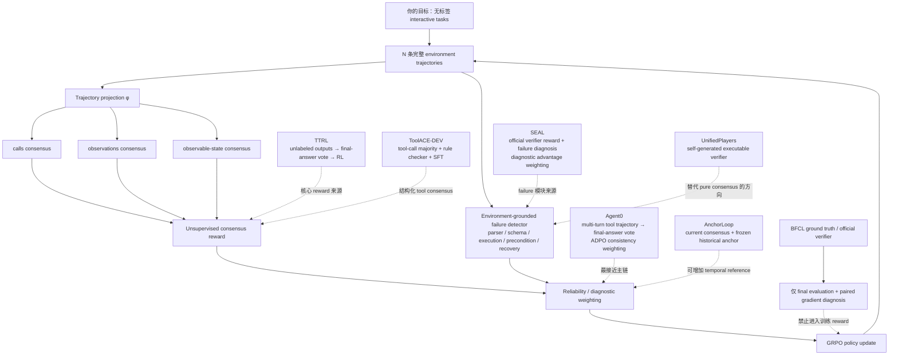
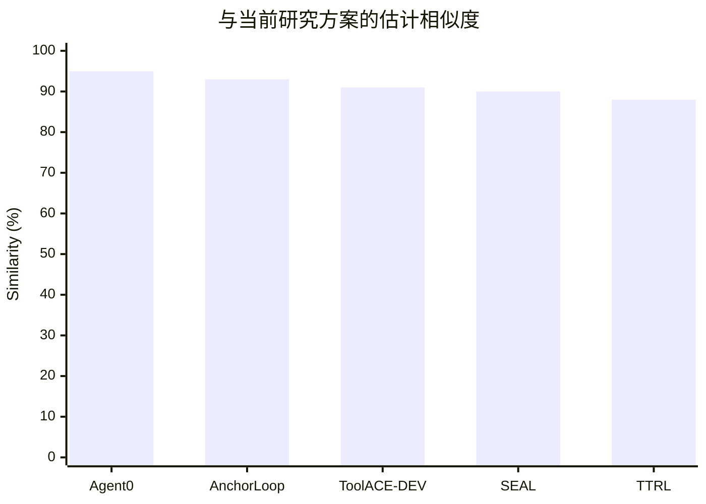

# LLM-based Agent 利用无监督信号实现 Self-Evolution：最接近论文与研究空白分析

## 执行摘要

截至 **2026 年 10 月 20 日**，我没有检索到一篇论文同时满足你当前研究方案的全部核心条件，即：

> **在真实多轮 LLM-agent/tool-use 交互环境中，不使用 ground truth、reference trajectory、人工评价或任务级官方 verifier reward 进行训练，仅利用多轨迹自身的一致性、公开 tool schema、真实环境返回与可观测执行证据构造 reward；再将 trajectory-level consensus 与 failure diagnosis 融入 RL 更新，并用 ground-truth reward 只做隔离的梯度方向诊断。**

因此，按你现在的严格 `unsupervised` 定义，**暂时没有发现“完全一样”的论文**。但这个结论不能理解为“当前方案已经天然具有足够创新性”：2025–2026 年已经出现一组非常接近的工作，几乎从不同方向包围了你的方法空间。

其中最需要警惕的是 **Agent0**。它已经实现了“tool-integrated multi-turn agent + 无外部标签 + 多 rollout + majority pseudo-label + RL + consistency-dependent advantage weighting”。换言之，仅仅把 TTRL 从单轮 reasoning 扩展成 Agent，并根据共识比例 $q$ 对 GRPO advantage 加权，**已经不足以作为主要创新点**。Agent0 的 Executor 对完整多步 tool trajectory 采样，最终用多数答案作为 pseudo-label，并使用 ADPO 根据 self-consistency $\hat p$ 缩放 advantage；这与你当前 TTRL→Agent 的主链条高度重合。citeturn20view0turn25view1

第二个危险信号是 2026 年 10 月刚出现的 **AnchorLoop**。它不仅继承 Agent0 的 self-consistency reward，而且与当前实现非常巧合地规定：**invalid/missing trajectory 不参与多数类别竞争、reward 为 0，但仍留在固定 group size 的分母中**；其 Executor 默认也是 $G=8$。它还明确指出“agreement ≠ correctness”，并引入上一轮冻结 Executor 作为历史 reference。citeturn21view0turn21view1turn21view3

第三个不能忽略的是 **ToolACE-DEV**：它早在 2025 年就已经针对 tool learning 使用未标注 query，自生成 candidate tools，对多个 tool invocation 进行 sampling 和 majority vote，并用规则检查器剔除 hallucinated tools、非法参数和错误类型，然后迭代 self-training；它还直接用 BFCL、API-Bank、T-Eval 做评价。它不是 multi-turn environment RL，而是 SFT/self-training，但已经占据了“**tool use + unlabeled queries + majority consensus + rule checking + self-evolution**”这一描述。citeturn24view0turn25view0

与你的附件相比：

- **TTRL** 是你“无标签多采样 → majority pseudo-label → binary reward → GRPO”的直接算法祖先。附件明确证明 majority reward 能在无 ground truth 下驱动 RL，并提出 Lucky Hit 解释；但原论文主要是数学/知识推理而非 Agent environment。fileciteturn0file1
- **SEAL** 则几乎与你计划的 failure detector、BFCL、多轮 tool-use、diagnosis-guided advantage reweighting 完全对位；但其根本差异极关键：SEAL 的基础 trajectory reward 来自 **official executable verifier**，failure diagnosis 只是重新加权这个有监督/可验证 advantage，而你目前试图让基础 reward 本身也来自无监督 consensus。fileciteturn0file2

所以，我认为你最有可能形成一篇有清晰独立贡献的论文，不能再定位为：

> “把 TTRL 应用于 Agent。”

而应定位成更具体的问题：

> **Can an interactive LLM agent construct reliable learning signals from its own environment-grounded trajectories, without task-level ground-truth verifiers?**

进一步把创新点收缩到三个目前尚未被上述工作完整覆盖的方向：

**第一，Trajectory Equivalence，而不是 Final-Answer Consensus。**  
Agent0/AnchorLoop/TTRL 最终都主要把 rollout 压成 final answer；你已经定义 `calls / observations / state` 三种 $\phi(\tau)$，即从“回答相等”推广为“交互过程或环境效果等价”。这是目前最值得保护的核心。你的汇报已经明确实现三种等价关系，并认识到不同表示会产生不同错误：`calls` 太严格，`observations` 可能把错误操作合并，`state` 又可能把不同过程合并到同一最终效果。fileciteturn0file0

**第二，Consensus 与 Environment-Grounded Failure Evidence 的双信号无监督 RL。**  
SEAL 已经做 failure-weighted RL，但其 base reward 是官方 verifier；ToolACE-DEV 有 rule checker，但不是 multi-turn RL；Agent0 有 consensus RL，但没有你这种公开 schema / executable precondition / recovery 的 failure attribution。把这三块真正放在一个严格 label-free setting 中，是目前最清晰的研究空白。fileciteturn0file0 fileciteturn0file2 citeturn20view0turn24view0

**第三，不只证明 reward agreement，而直接研究“无监督 signal 是否产生正确优化方向”。**  
你现在的 paired gradient diagnostic 比较同一参数点、同一 rollout 下 $g_u$ 与 ground-truth-reward $g_s$ 的 cosine，这是非常好的分析工具。至少在本次检索到的最接近工作中，我没有看到 Agent0、AnchorLoop、TTRL、SEAL 用这种“oracle reward gradient 仅作为 post-hoc scientific probe”的方式验证 pseudo-reward 的更新方向。你的 smoke test 目前因为 supervised GRPO 组内同分而产生零梯度，所以还没有得到正面证据，但这个失败本身说明指标设计是必要的。fileciteturn0file0

以下相似度不是论文作者给出的数字，而是本报告按照五个维度做的研究判断：

$$
S=
0.20S_{\text{goal}}
+0.30S_{\text{unsup-signal}}
+0.20S_{\text{agent}}
+0.20S_{\text{optimization}}
+0.10S_{\text{evaluation}}.
$$

其中 **unsupervised signal construction 权重最高**，因为你已明确“不强调 deployment/test-time，而聚焦 unsupervised signals 与 self-evolution”。

## 研究基准与相似度口径

你目前的研究已经比标题“LLM Agent + unsupervised self-evolution”具体得多。根据 `261014_汇报.md`，现阶段实际上是在研究如下闭环：

$$
x
\rightarrow
\{\tau_1,\ldots,\tau_N\}
\rightarrow
\phi(\tau)
\rightarrow
\text{consensus}
\rightarrow
R_{\text{est}}
\rightarrow
\text{GRPO}
\rightarrow
\pi_{\theta'}
$$

其中训练时不读取 BFCL reference answer、reference tool call 或官方 pass/fail；允许的信息是 user request、公开 tool schema、agent 自身调用、tool returns、执行错误和部署/交互时本来就可观测的状态。官方答案只用于最终评价以及隔离的 paired-gradient diagnostic。fileciteturn0file0

与原 TTRL 最大的技术变化是你定义了

$$
X_i=\phi(\tau_i)
$$

而 $X_i$ 不再只是一个数学答案，而可以是：

$$
\phi_{\mathrm{call}}(\tau),\qquad
\phi_{\mathrm{obs}}(\tau),\qquad
\phi_{\mathrm{state}}(\tau).
$$

在有效轨迹上求 modal class $e(M)$，再给

$$
R_{\mathrm{cons},i}
=
v_i\mathbf 1[X_i=e(M)].
$$

无效轨迹不进入类别竞争，但仍进入 $N$ 的分母；当前 tie-breaking 是选最早出现的最高频类别。你还提出基于共识度

$$
q=\frac{M_{e(M)}}{N}
$$

的 U-shaped weighting：

$$
w(q)=f+(1-f)|2q-1|^p,
$$

试图同时利用“高 $q$ 的可信 consensus”和“低 $q$ 下 Lucky Hit 可能仍带来大量正确负奖励”两端。需要强调：你自己的笔记已经正确指出，**reward accuracy 高不等于 policy-gradient direction 好**，而 Agent 场景还存在多个合法终态和 projection aliasing，因此 TTRL 的单一正确答案分析不能直接成为证明。fileciteturn0file0

这也是我下面判断相似性的基准。尤其值得注意的是，你现在已经明确“不强调部署/test-time”。因此这里把 TTRL 中的 “test-time” 看成数据来源的一种实例，而把真正与你有关的核心抽象为：

> **Self-generated / environment-derived supervision on unlabeled interactive data.**

下图给出当前方案和最接近工作的结构关系：



TTRL 的附件显示其核心是 majority-voted pseudo-label 驱动 unlabeled-data RL；Agent0 已把该思想扩展到多轮 Python tool trajectory；SEAL 则把 executable failure diagnosis 用于学习接口和 advantage；AnchorLoop 又增加历史模型 reference；UnifiedPlayers 进一步说明 2026 年的研究前沿已经开始从“self-consistency 是 verifier”转向“agent 自己生成 executable verifier”。fileciteturn0file1 fileciteturn0file2 citeturn20view0turn21view3turn27view1

## 完全重合的论文

### 结论：目前没有发现完全重合者

我采用一个比较严格的“完全重合”标准：论文至少要同时满足以下研究条件。

| 维度 | 你的当前设定 | 是否已有论文同时满足 |
|---|---|---|
| 数据 | unlabeled interactive tasks；训练不可读 reference answer / correct trajectory | 有相近工作 |
| 研究对象 | multi-turn LLM-based agent，与可执行环境交互 | 有相近工作 |
| reward 主信号 | 从自身多 trajectory 构造，无 official task-level verifier reward | 有相近工作 |
| consensus 单元 | 不局限 final answer，而比较 calls / observations / observable state | **未找到完全相同** |
| failure signal | 仅用公开 schema、parser、execution evidence、observable precondition/recovery | 有部分相近工作 |
| 优化 | consensus + failure signal 共同影响 RL advantage | **未找到完全相同组合** |
| scientific validation | ground-truth reward 只隔离用于 paired gradient-direction diagnostic | **未找到完全相同** |

你的 unsupervised 边界、三种 trajectory projection、failure detector 和 gradient diagnostic 均在当前汇报中已有明确设计。fileciteturn0file0

因此，目前最准确的结论不是“有人已经完全做过”，而是：

> **核心零件几乎都有人做过，但没有检索到一篇论文按照你现在的监督边界，把这些零件以同一种方式组合起来。**

这是一种**组合创新仍有空间、单模块创新已非常拥挤**的状态。

### 最接近“完全撞车”的是 Agent0

**论文：** *Agent0: Unleashing Self-Evolving Agents from Zero Data via Tool-Integrated Reasoning*  
**作者：** Peng Xia, Kaide Zeng, Jiaqi Liu, Can Qin, Fang Wu, Yiyang Zhou, Caiming Xiong, Huaxiu Yao  
**年份：** 2025  
**原文：** [arXiv:2511.16043](https://arxiv.org/abs/2511.16043)  
**相似度：95%**。citeturn20view0

Agent0 从同一个 base LLM 初始化 Curriculum Agent 和 Executor Agent，前者自动产生 frontier tasks，后者通过 multi-step tool-integrated rollout 学习；Executor 每个 task 采样 $k$ 条轨迹，取 final answers 的 majority answer $\tilde y$，并给

$$
R_i=\mathbf 1[o_i=\tilde y].
$$

随后用 GRPO/ADPO 更新完整 trajectory。Agent0 还计算 self-consistency

$$
\hat p(x)=
\frac1k
\sum_i
\mathbf 1[o_i=\tilde y],
$$

并用 $\hat p$ 调节 advantage 大小；低 consistency 被认为 pseudo-label 更不可靠，因此 advantage 被下调，同时放宽 PPO upper clipping，让低概率探索路径更容易成长。citeturn20view0turn25view1

它的实验使用 Qwen3-4B/8B Base、Python sandbox，多轮 trajectory 中 code execution 的输出会作为下一步 observation 返回模型。论文报告 Qwen3-8B-Base 数学平均和 general reasoning 都显著提升，并称整体数学 reasoning 提升约 18%、general reasoning 约 24%。citeturn20view0turn25view1

**与你完全重合之处：**

$$
\text{multi-rollout}
\rightarrow
\text{consensus pseudo-label}
\rightarrow
\text{trajectory reward}
\rightarrow
\text{group-relative RL}
$$

以及

$$
q/\hat p
\rightarrow
\text{advantage weighting}.
$$

这意味着 **“将 TTRL majority reward 扩展到 multi-turn agent trajectory”不能单独成为你的 novelty claim**。citeturn20view0

但它没有完全覆盖你的核心创新，因为 Agent0 的 equivalence class 本质上仍是

$$
\phi_{\text{Agent0}}(\tau)=
\text{FinalAnswer}(\tau),
$$

而你的研究是显式研究

$$
\phi(\tau)
\in
\{
\text{calls},
\text{observations},
\text{observable state}
\}.
$$

换言之，同一个最终答案下，两条完全不同甚至过程错误的 Agent trajectory 在 Agent0 中可能属于同一 pseudo-label，而你的研究恰恰在问：**Agent 的“consensus”究竟应该定义在 action、observation 还是 environment effect 上？** Agent0 也没有你现在的 parser/schema/precondition/recovery failure detector 与 oracle-gradient alignment diagnostic。fileciteturn0file0 citeturn20view0

**你能学到什么：** 最直接的是 ADPO 应成为你 q-weighting 的强 baseline。你当前的 U-shaped weighting 在低 $q$ 区域重新增加权重，而 Agent0 采取近乎相反的观点：低 consistency 意味着 pseudo-label 不可靠，应降低 advantage，只在 exploration trust region 上更宽松。citeturn20view0

这会形成一个非常有价值的实验：

$$
\boxed{
\text{uniform}
\quad vs\quad
\text{Agent0 monotonic}
\quad vs\quad
\text{你的 U-shape}
\quad vs\quad
\text{learned/calibrated weighting}
}
$$

而你的 paired gradient cosine 可以直接判断这些 weighting 到底哪一种更接近 oracle update direction。fileciteturn0file0

### 最新的结构性撞车是 AnchorLoop

**论文：** *Self-Evolve With a Reference: Anchored Training of Tool-Integrated Agents*  
**作者：** Wenjie Liao, Liangjie Zhao, Zehong Cao  
**年份：** 2026  
**原文：** [arXiv:2610.09856](https://arxiv.org/abs/2610.09856)  
**相似度：93%**。citeturn17academia0

AnchorLoop 直接建立在 Agent0 paradigm 上，同样让 Executor 针对一个 task 生成 $G$ 个 multi-turn tool trajectories，并把 valid final answers 的唯一众数作为 pseudo-label：

$$
r_i=
\mathbf 1[o_i=\tilde y].
$$

它非常值得你注意的工程细节是：

> invalid 和 missing output 不参与 modal label 投票、reward 为 0，但是仍留在固定 $G=8$ 的分母中。citeturn21view1turn21view3

这与你汇报中

> 无效轨迹 $X_i=\bot$ 不参加类别竞争，也不获正奖励，但仍计入 $N$ 分母

高度重合。fileciteturn0file0

AnchorLoop 的新增贡献是在每轮保留上一版本 Executor 作为 frozen anchor，使当前 trajectory 同时与 current majority 和 historical majority 比较。论文明确警告，其 agreement-based reference **并不代表 correctness**；更集中的错误分布同样可能获得较高 agreement。实验中 AnchorLoop 相比 Agent0 在 math 平均上再提高约 2.5 点、general reasoning 再提高约 2.8 点，并保持更高的有效 advantage variance。citeturn17academia0turn21view0

与你的不同是它依然只对 final answer 定义等价类，而且无法利用 BFCL 环境本身的调用、状态和约束证据。你的 tie 策略也不同：当前实现最高票并列取最早类别，而 AnchorLoop 对不存在唯一 mode 的 group 标记 unresolved，并从需要 pseudo-label 的 Executor update 中剔除。fileciteturn0file0 citeturn21view3

**你能学到什么：** 建议把 “tie policy” 和 “historical anchor” 直接放入消融实验。特别是不要默认为“最早出现类别”是无害实现细节：

$$
\text{earliest-tie}
\quad vs\quad
\text{drop-tie}
\quad vs\quad
\text{soft-frequency}
\quad vs\quad
\text{historical-anchor disambiguation}.
$$

这很可能比继续设计更多人工 $q$-curve 更有学术说服力。

## 大部分重合的论文

下面这五篇是按你**现在的具体方案**，而不是按泛泛的 “self-evolving agent” 关键词排序。

| 论文 | 相似度 | 与你相同 | 核心不同 | 创新点对比 | 你最应该借鉴什么 |
|---|---:|---|---|---|---|
| **Agent0: Unleashing Self-Evolving Agents from Zero Data via Tool-Integrated Reasoning** — Peng Xia, Kaide Zeng, Jiaqi Liu, Can Qin, Fang Wu, Yiyang Zhou, Caiming Xiong, Huaxiu Yao, 2025. [原文](https://arxiv.org/abs/2511.16043) citeturn20view0 | **95%** | 无外部标签、自生成 feedback、multi-turn tool rollout、majority pseudo-label、GRPO、consistency weighting | 主要按 final answer 聚合；Python reasoning；自生成 curriculum；无 calls/obs/state equivalence 与 deterministic failure diagnosis | 它已覆盖“Agent-TTRL + q weighting”；你必须转向 **environment-grounded trajectory consensus** | ADPO monotonic weighting、dynamic clipping、frontier-task filtering，全部作为强 baseline |
| **AnchorLoop: Self-Evolve With a Reference** — Wenjie Liao, Liangjie Zhao, Zehong Cao, 2026. [原文](https://arxiv.org/abs/2610.09856) citeturn17academia0turn21view3 | **93%** | tool-integrated multi-turn、self-consistency RL、invalid 不投票但留分母、$G=8$、无外部 answer label | 增加 frozen historical executor；final-answer equivalence；tie 直接 unresolved | 它削弱“q/invalid handling”的独创性；你的差异在 interaction semantics 和 failure grounding | 引入 temporal anchor，测试 current-only vs current+previous consensus；取消 arbitrary tie-breaking |
| **ToolACE-DEV: Self-Improving Tool Learning via Decomposition and EVolution** — Xu Huang, Weiwen Liu, Xingshan Zeng, Yuefeng Huang, Xinlong Hao, Yuxian Wang, Yirong Zeng, Chuhan Wu, Yasheng Wang, Ruiming Tang, Defu Lian, 2025. [原文](https://arxiv.org/abs/2505.07512) citeturn24view0 | **91%** | tool learning、unlabeled incoming queries、multiple sampling、majority invocation、rule checker、iterative self-evolution、BFCL | 主要 single-turn function calling；SFT 而非 on-policy RL；预备阶段用了 ToolACE 和 20k GPT-4 synthetic samples | 已覆盖“tool-call consensus + format/schema filter + self-training”；你必须突出 **multi-turn environment effect + strict label-free RL** | 对 candidate tool/call 做 canonicalization；rule checker 与 consensus 分层；加入 SFT pseudo-label baseline |
| **SEAL: Synergistic Co-Evolution of Agents and Learning Environments** — Yihao Hu, Zhihao Wen, Xiujin Liu, Pan Wang, Xin Zhang, Wei Wu, 2026. [原文](https://arxiv.org/abs/2605.24426) fileciteturn0file2 | **90%** | BFCL V3 multi-turn、Qwen2.5-3B/7B、8 rollout、GRPO、turn-level deterministic failure diagnosis、advantage weighting、OOD 到 BFCL V4/$\tau^2$-bench | **基础 reward 是 official executable verifier success**；还修改 training interface；你的基础 reward 是 consensus 且严格不读 GT | SEAL 已覆盖“failure detection → advantage weight”；你的创新必须是 **用无标签信号替换 verifier reward，同时保持诊断可落地** | failure taxonomy、recovered/unrecovered credit、trajectory utility weight、OOD protocol；但不能照搬其 verifier-dependent diagnosis |
| **TTRL: Test-Time Reinforcement Learning** — Yuxin Zuo, Kaiyan Zhang, Li Sheng, Shang Qu, Ganqu Cui 等, 2025. [原文](https://arxiv.org/abs/2504.16084) fileciteturn0file1 | **88%** | unlabeled inputs、多采样、majority label、binary self-reward、GRPO、Lucky Hit、online iterative improvement | 非 interactive agent；输出只有 answer，没有 action/observation/state；没有 environment failure signals | 你已经不是简单复现 TTRL，而是在研究 **TTRL 的等价关系在 Agent trajectory 上如何定义** | 保留作为最核心 baseline；把 majority reward accuracy、label accuracy、entropy、q 等指标迁移到 trajectory setting |

这五篇的相似度分布可以直观看成：



### Agent0：为什么是当前最大的 novelty threat

Agent0 的关键不仅是“会用工具”，而是已经把 **full multi-step trajectory** 当作 RL 的优化单位。它在工具执行时将 Python output/error 返回到上下文，直至生成最终答案，再以 majority pseudo-label 给整个 trajectory outcome reward。citeturn20view0

它还直接指出低 self-consistency 的 pseudo-label 更容易错误，因此：

$$
\tilde A_i=A_i f(\hat p)
$$

并令 $f$ 随一致性上升。你现在的 q-weighting 也作用在标准化后的 advantage 上，这个操作位置已经非常接近。fileciteturn0file0 citeturn20view0

但这里反而产生了你一个很好的研究问题：

> **对于 agent trajectory，final-answer consistency 的 reliability 规律还成立吗？**

例如：

- calls 低一致，但 state 高一致：很可能只是存在多种等价计划；
- observations 高一致，但 state 错误：可能所有错误调用都返回同类 “ok”；
- state 高一致，也可能所有 rollout 都陷入同一个 systematic failure。

因此你的 $q$ 不应该只有一个：

$$
q_{\text{call}},\quad
q_{\text{obs}},\quad
q_{\text{state}}.
$$

更进一步可以研究

$$
P(\text{correct gradient}
\mid
q_{\text{call}},
q_{\text{obs}},
q_{\text{state}},
z_{\text{failure}}).
$$

这比单独提出一条 U-shaped $w(q)$ 更有研究价值。

### ToolACE-DEV：它已经做了你的“浅层版本”

ToolACE-DEV 是一个很容易被遗漏、但审稿人很可能指出的先行工作。它在 self-evolution round 中对新 query 先自行生成 candidate tools，然后多次生成 tool invocations，以 majority vote 选 pseudo ground truth；规则 checker 会过滤不存在的 tools、非法 argument 以及参数类型错误。citeturn24view0

它的模型更新则是 SFT：

$$
\Theta^{(i+1)}
=
\arg\min_\Theta
\ell(f(q,\tilde T,\Theta),\tilde A)
+
\ell(f(x_q,\Theta),\tilde T).
$$

每轮使用 10,000 incoming queries，最多三轮；论文报告 self-evolution 各轮 BFCL performance 持续上升，ToolACE-DEV 在当时 BFCL 配置下得到 82.44 overall，并在 API-Bank 从 Llama-3.1-8B 的 54.11 提高到 67.82。citeturn24view0turn25view0

所以论文里最好不要写：

> “We are the first to use self-consistency for self-evolving tool agents.”

这个 claim 基本不成立。

更安全、也更准确的是：

> “Existing tool self-evolution largely constructs supervision over final answers or static tool invocations; we study how unlabeled **environment interaction trajectories themselves** can define reliable reward equivalence classes.”

### SEAL：最接近你后半部分，但存在决定性监督差异

SEAL 的框架与你即将做的 failure module 非常接近。它从 parser、schema validation、execution errors、observable state transitions 和 verifier comparisons 中构造 turn-level diagnosis，再把 failure profile 一方面用于训练接口 evolution，另一方面构成正的 trajectory weight

$$
\tilde A_j=w_j A_j.
$$

权重只改变 magnitude、不改变原 advantage 的 sign。fileciteturn0file2

SEAL 在 400 个 BFCL V3 training examples 上训练，Qwen2.5-7B-Instruct 的平均分从 14.00 提高到 40.25，Vanilla RL 为 30.75；同时还报告 BFCL V4 和 $\tau^2$-bench 的 OOD transfer。fileciteturn0file2

但 SEAL 的式子是：

$$
r(\tau)=\mathcal V(\tau,q,\mathcal E)\in\{0,1\},
$$

其中 $\mathcal V$ 是 benchmark/executable verifier。也就是说 diagnosis 不是在“凭空发现 trajectory 的任务成功性”，而是在已经存在一个可靠 task success reward 的前提下，告诉模型失败发生在哪里。fileciteturn0file2

你的 setting 则刻意禁止这一点：

$$
R_{\text{base}}
=
R_{\text{consensus}},
$$

官方 BFCL checker 不能进入优化。fileciteturn0file0

因此，可以非常明确地构造一个论文主问题：

$$
\boxed{
\text{Can SEAL-like diagnostic learning work when }\mathcal V\text{ itself is unavailable?}
}
$$

这是目前最值得做的切口之一。

### TTRL：你的理论祖先，但不是你的最终竞争对象

TTRL 在 unlabeled reasoning task 上采样多个 response，以多数答案作 estimated label，然后

$$
R(\hat y_i,\bar y)
=
\mathbf 1[\hat y_i=\bar y]
$$

作为 RL reward。主实验使用 GRPO；附件报告 Qwen2.5-Math-7B 在 AIME 2024 sampled pass@1 中由 12.9 提高到 40.2，同时在 AMC、MATH-500 等任务上有大幅提升。作者还显示 TTRL 可以超过初始模型的 maj@n，并接近直接使用 ground-truth test labels 做 RL 的经验上界。fileciteturn0file1

真正值得你保留的是 TTRL 的 **Lucky Hit** 观察：即使 majority pseudo-label 错误，只要某个错误 sample 与错误 pseudo-label 不同，它仍会被正确地赋予负 reward。因此 reward accuracy 可以显著高于 label accuracy。fileciteturn0file1

但你已经正确识别出它在 Agent 上的漏洞：

$$
\text{high reward agreement}
\not\Rightarrow
\text{correct policy gradient}.
$$

这一点建议成为你的论文分析主线，而不只是实现附录。fileciteturn0file0

### 一个必须额外关注的 2026 年竞争者：UnifiedPlayers

虽然没有把它挤进上面的五篇，是因为它的问题设定比你的 BFCL/general-tool agent 更偏 tool-integrated reasoning，但它对“下一步该怎么超越 consensus”非常重要。

*UnifiedPlayers: Enhance Tool-Integrated Reasoning in Agentic Reinforcement Learning*（Wenjie Liao, Liangjie Zhao, Zehong Cao, 2026）让 Planning、Execution、Evaluation 三个 Player 同时进化；Evaluation Player 不靠 majority answer，而是为每道任务生成可执行 Python verifier，并通过对 original trajectory 与自动扰动后的 adversarial trajectories 进行执行检查来训练 verifier。其 learned verifier 报告 84.2% adversarial detection accuracy，且 reward 的 per-question variance 是 self-consistency baseline 的 2.03 倍。citeturn27view1turn27view2

原文：[arXiv:2609.20089](https://arxiv.org/abs/2609.20089)

这意味着前沿已经开始明确攻击 majority voting 最大的问题：

> **多个 trajectory 的 agreement 仍然可能只是 correlated error。**

因此你不能只讨论如何“更聪明地投票”；需要证明 **environment evidence 为什么能够打破 correlated-error mode**。

## 方法论相似的论文

这里选的是研究对象不完全相同，但可以直接迁移机制到你项目中的五篇工作。

### CSRS：不要把 majority frequency 压成一个二值标签

**论文：** *Stabilizing Unsupervised Self-Evolution of MLLMs via Continuous Softened Retracing reSampling*  
**作者：** Yunyao Yu, Zhengxian Wu, Zhuohong Chen, Hangrui Xu, Zirui Liao, Xiangwen Deng, Zhifang Liu, Senyuan Shi, Haoqian Wang  
**年份：** 2026  
**相似度：80%**  
**原文：** [arXiv:2604.03647](https://arxiv.org/abs/2604.03647) citeturn18academia0

CSRS 研究的是 multimodal reasoning，不是 tool agent，但它正面指出多数投票 pseudo-golden answer 可能只是模型 intrinsic bias 的集中体现。为此它提出两个非常适合你的模块：**Softened Frequency Reward** 用连续频率替代 hard binary majority reward；**Retracing Re-inference** 则从中间 anchor point 重新推理，以探索被 majority 压制的 long-tail path。citeturn18academia0

你的当前规则是：

$$
R_i^{\text{hard}}
=
\mathbf 1[X_i=e(M)].
$$

可以增加一组非常自然的 baseline：

$$
R_i^{\text{freq}}
=
\frac{M_{X_i}}{N},
$$

或者 temperature-softened：

$$
R_i^{\text{soft}}
=
\frac{\exp(M_{X_i}/T)}
{\sum_c\exp(M_c/T)}.
$$

这样就不再把第二大 trajectory cluster 和只出现一次的 outlier 同时打成 0。

**你能学到什么：**  
当前 `calls` equivalence 很容易因为调用顺序不同而碎裂。hard majority 会丢掉大量潜在正确轨迹，而 frequency reward 正好能检验这个问题。建议同时记录：

$$
H(X)
=
-\sum_c p_c\log p_c
$$

而不仅仅是 $q=\max_c p_c$。两个 case 都可能 $q=0.5$，但一个是 $0.5/0.5$，另一个是 $0.5/0.1/0.1/0.1/0.1/0.1$，训练意义完全不同。

### Trinity：用时间稳定的 self-verifier 破解“当前模型自证”

**论文：** *Trinity: Self-Evolving Vision-Language Models with a Self-Verifier*  
**作者：** Youngwan Lee, Yong-Ju Lee, Sung Ju Hwang  
**年份：** 2026  
**相似度：78%**  
**原文：** [arXiv:2610.04469](https://arxiv.org/abs/2610.04469) citeturn18academia1

Trinity 用 unlabeled images 进行 VLM self-evolution，但认为简单 agreement 不能判断“大家是否一起错”。它让同一个 VLM 扮演 Questioner、Solver、Verifier，而 Verifier 是 policy 的 **EMA copy**，不需要人工 label 或 external judge。Verifier 对 generated questions 做 grounding/checking，并在 reference 与 strong solver consensus 冲突时进行仲裁。论文报告 Qwen3-VL-8B 在 MathVerse 等 benchmark 上有明显提升。citeturn18academia1

这对应你可以加入：

$$
\theta_{\mathrm{ema}}
\leftarrow
\beta\theta_{\mathrm{ema}}
+(1-\beta)\theta.
$$

然后不是让 EMA model 直接“说哪条轨迹正确”，而是让它判断更受约束的问题，例如：

- 两个 final observable state 是否语义等价？
- 某个 schema violation 是否真实发生？
- 某个 recovery 是否确实消除了先前 failure？
- 两种 consensus representation 是否冲突？

**创新点对比：** Trinity 的 self-verifier 仍主要是模型-based verification；你的优势是很多 tool-agent failure 可以用 deterministic executable evidence 判断。因此更稳妥的是：

$$
\text{deterministic evidence}
>
\text{EMA self-verifier}
>
\text{raw consensus}
$$

构造一个 evidence hierarchy，而不是全都交给 LLM judge。

### Program-Verified Self-Evolution：把自然语言 trajectory 先转换成结构化事实

**论文：** *Program-Verified Self-Evolution for Vision-Language Models*  
**作者：** Ahmed Heakl, Sungik Choi, Moontae Lee, Salman Khan  
**年份：** 2026  
**相似度：76%**  
**原文：** [arXiv:2609.33855](https://arxiv.org/abs/2609.33855) citeturn18academia3

这篇论文的结论对你的 `state` projection 尤其重要。作者发现其场景中 human evaluation 下 majority-vote labels 有 24% 错误、model-judge labels 有 18% 错误，于是不再直接 vote answer，而是先把 image 解析成 structured record，再由固定程序从这个结构产生 QA 和答案。报告中这种 VQS 的 answer correctness 达到 94%，而 majority voting 为 76%。citeturn18academia3

迁移到你的 Agent，可以把思路改成：

```text
raw trajectory
      ↓
canonical executable record
      ↓
{actions, arguments, observations, state deltas, failures}
      ↓
deterministic normalization / equivalence rules
      ↓
consensus
```

而不是：

```text
raw trajectory
      ↓
string equality
      ↓
consensus
```

你当前已经在 canonicalize dictionary keys、保留 list order 与 duplicates，但仍可以进一步将环境语义结构化。fileciteturn0file0

例如文件系统：

$$
\phi_{\text{state}}(\tau)
=
\{\text{canonical directory tree}\}
$$

显然比比较文本 observation 更接近用户真正关心的 task effect。

**你能学到什么：** 可以把论文主贡献进一步升级为

> **Environment-grounded canonical trajectory representations for unsupervised reward construction.**

这比简单“多数投票”更容易与 Agent0/TTRL 划出边界。

### GENIUS：从 trajectory-level reward 向 step-level credit 迁移

**论文：** *Genius: A Generalizable and Purely Unsupervised Self-Training Framework For Advanced Reasoning*  
**作者：** Fangzhi Xu, Hang Yan, Chang Ma, Haiteng Zhao, Qiushi Sun, Kanzhi Cheng, Junxian He, Jun Liu, Zhiyong Wu  
**年份：** 2025  
**相似度：72%**  
**原文：** [arXiv:2504.08672](https://arxiv.org/abs/2504.08672) citeturn18academia2

GENIUS 在 general reasoning 上做 fully unsupervised self-training，利用 **stepwise foresight re-sampling**：从中间 reasoning step 继续采样未来结果，据此估计当前 step 的 value；同时用 Advantage-Calibrated Optimization 应对 unsupervised signal 的噪声和不一致性。citeturn18academia2

这与你下一步想解决的“整条 trajectory 一个 reward 太粗”非常一致。fileciteturn0file0

在 Agent 场景可以把某一步 $t$ 的局部 value 定义为：

$$
V_t
=
P(
\phi(\tau_{t:T})\in C^*
\mid
h_t
)
$$

的无标签估计。

实际实现不用知道真正 $C^*$，可以从当前 prefix $\tau_{1:t}$ 重新 rollout $K$ 次：

```text
for step t in trajectory:
    fork environment state s_t
    sample K continuations
    compute continuation consensus / valid-state ratio
    compare with consensus before action t
    estimate ΔV_t
```

例如：

$$
\Delta V_t
=
q_{\text{after},t}
-
q_{\text{before},t}.
$$

若一个 tool call 后 future continuation 的 agreement、validity 或 state consistency 大幅下降，就可以给它更负的 process signal。

这样你的 failure detector 也不只是 trajectory-level `w_j`，而能真正变成 turn-level credit assignment。

### Semantic Voting：从 exact equality 转向“等价关系学习”

**论文：** *Semantic Voting: A Self-Evaluation-Free Approach for Efficient LLM Self-Improvement on Unverifiable Open-ended Tasks*  
**作者：** Chunyang Jiang, Yonggang Zhang, Yiyang Cai, Chi-Min Chan, Yulong Liu, Mingming Chen, Wei Xue, Yike Guo  
**年份：** 2025  
**相似度：71%**  
**原文：** [arXiv:2509.23067](https://arxiv.org/abs/2509.23067) citeturn26academia0

Semantic Voting 指出 exact-match majority 不适合开放式输出，因此用轻量 embedding 将 hard matching 放宽为 semantic similarity，再进行聚合。citeturn26academia0

你的 `calls` 模式最容易遇到同一问题。例如：

```text
CreateFolder(A) → CreateFolder(B)
```

和

```text
CreateFolder(B) → CreateFolder(A)
```

若两者在环境语义上可交换，当前 calls-consensus 会把它们拆成两个 class。你已经在汇报中明确记录了这个边界。fileciteturn0file0

但在 Agent 中我不建议直接用 generic sentence embedding。更稳妥的是设计 **environment-specific equivalence**：

$$
\tau_i\sim\tau_j
\iff
\phi_E(\tau_i)=\phi_E(\tau_j),
$$

其中 $\phi_E$ 可以考虑：

- commute-able independent actions；
- canonicalized arguments；
- state delta；
- final state；
- side effects；
- unresolved failures。

于是研究问题从 “Which trajectory is majority?” 升级为：

> **What is the right equivalence relation over agent experiences for self-supervised RL?**

我认为这可能是你整篇论文最有理论味道、也最区别于 Agent0 的切入点。

### 推荐的综合训练流程

结合上述工作，我更建议把你当前“consensus + failure weighting”改造成一个**分层证据模型**：

```text
Evidence reliability:
deterministic execution fact
      >
public-schema violation
      >
observable-state equivalence
      >
observation consensus
      >
action/call consensus
      >
model-only semantic judgement
```

伪代码可以写成：

```text
for unlabeled task x:
    τ[1:N] = rollout(policy, environment, x)

    # Structure / canonicalization
    for τ_i in τ:
        c_i = canonicalize_calls(τ_i)
        o_i = canonicalize_observations(τ_i)
        s_i = observable_final_state(τ_i)
        z_i = deterministic_failure_events(
            τ_i,
            public_schema,
            execution_evidence
        )

    # Multi-view consensus
    q_call,  C_call  = consensus(c[1:N])
    q_obs,   C_obs   = consensus(o[1:N])
    q_state, C_state = consensus(s[1:N])

    # Base pseudo reward
    R_i = combine_consensus(
        C_call, C_obs, C_state,
        reliability=(q_call, q_obs, q_state)
    )

    # Local hard evidence can veto/discount consensus
    R_i, process_reward_i = apply_grounded_failures(R_i, z_i)

    # Optional temporal reference
    R_i = cross_reference(R_i, frozen_anchor_rollouts)

    # GRPO
    A_i = group_normalize(R_i)
    A_i = reliability_weight(
        A_i,
        q_call, q_obs, q_state,
        z_i
    )

    update_policy(A_i, process_reward_i)
```

这里最重要的是避免简单地写：

$$
\tilde A=w(q)A.
$$

因为 Agent0 已经有这样的 family。更有区别度的是：

$$
\boxed{
\tilde A_i
=
w(
q_{\text{call}},
q_{\text{obs}},
q_{\text{state}},
H(X),
z_i,
\text{anchor agreement}
)
A_i
}
$$

并用你的 gradient diagnostic 来验证这个 reliability model 是否真的提高

$$
\cos(g_u,g_s).
$$

## 理论基础相同的论文

从理论上看，你的工作并不只属于“LLM Agent”。它横跨四条成熟路线：

$$
\text{pseudo-label self-training}
+
\text{consistency regularization}
+
\text{automatic curriculum}
+
\text{reinforcement learning under noisy rewards}.
$$

跨领域理论工作反而能帮你把论文从“工程组合”提升为有明确假设和实验原则的研究。

| 理论论文 | 相似度 | 理论核心 | 与你的创新点差异 | 可以直接迁移的实验 |
|---|---:|---|---|---|
| **FixMatch** — Kihyuk Sohn, David Berthelot, Chun-Liang Li, Zizhao Zhang, Nicholas Carlini, Ekin Cubuk, Alex Kurakin, Han Zhang, Colin Raffel, 2020. [原文](https://arxiv.org/abs/2001.07685) citeturn15academia0 | **64%** | confidence-thresholded pseudo-label + consistency regularization | 图像分类，无 RL/agent trajectory | 用 trajectory perturbation 验证 pseudo-label consistency；只更新稳定 case |
| **Noisy Student** — Qizhe Xie, Minh-Thang Luong, Eduard Hovy, Quoc V. Le, 2020. [原文](https://arxiv.org/abs/1911.04252) citeturn15academia1 | **59%** | teacher pseudo-label + noisy student + iterative teacher replacement | vision semi-supervised；有初始 labeled teacher | frozen/EMA previous policy 当 teacher，当前 policy 在扰动环境下作为 student |
| **PAIRED / Unsupervised Environment Design** — Michael Dennis, Natasha Jaques, Eugene Vinitsky, Alexandre Bayen, Stuart Russell, Andrew Critch, Sergey Levine, 2020. [原文](https://arxiv.org/abs/2012.02096) citeturn16academia1 | **62%** | 根据 learner capability 自适应生成环境；用 regret 避免太易/不可解任务 | procedural RL environment，不是 LLM | 根据 current-vs-anchor disagreement 选 task，替代手工 q 阈值 curriculum |
| **Prioritized Level Replay** — Minqi Jiang, Edward Grefenstette, Tim Rocktäschel, 2020. [原文](https://arxiv.org/abs/2010.03934) citeturn15academia2 | **57%** | 根据 learning potential 而非均匀采样 replay task | Procgen RL，不构造 pseudo-label | 用 reward disagreement、failure density、gradient informativeness 决定 BFCL case replay priority |

### FixMatch：你需要“confidence”之外的 consistency test

FixMatch 的思想并不是“高置信度预测一定正确”，而是先对 unlabeled sample 产生高 confidence pseudo-label，再要求强 augmentation 后模型仍预测该 label。它通过 confidence threshold 和 consistency regularization 联合筛选伪监督。citeturn15academia0

迁移到 Agent 最有价值的不是简单设置

$$
q>\tau,
$$

而是问：

> 同一个 case 在不改变任务语义的 perturbation 下，trajectory pseudo-label 是否稳定？

可以做：

- tool descriptions paraphrase；
- tool order shuffle；
- irrelevant tool injection；
- equivalent initial-state serialization；
- harmless observation wording perturbation；
- sampling temperature change。

然后定义：

$$
C(x)
=
P[
e(M^{(a)})
\sim_E
e(M^{(b)})
].
$$

只在

$$
q>\tau_q
\quad\land\quad
C(x)>\tau_c
$$

时给予高权重。

**可学习之处：** 你的可靠性度量就从单变量 $q$ 升级成“**confidence + invariance**”。这是解决 systematic consensus error 的一个很自然方法。

### Noisy Student：不要让 teacher 和 student 完全是同一个瞬时模型

Noisy Student 在 ImageNet self-training 中用 teacher 为 unlabeled data 产生 pseudo-label，再训练加入 dropout、augmentation 等噪声的 student，并迭代地把更强 student 变成 teacher。论文报告该策略不仅提升标准 ImageNet，也显著改善 ImageNet-A/C/P 等 robustness benchmark。citeturn15academia1

它给你的核心启示正好对应 AnchorLoop/Trinity：

$$
\text{current policy generates signal for itself}
$$

存在强烈 correlated error 风险。

因此可以保留：

$$
\pi_{\text{anchor}}
=
\pi_{\theta_{t-k}}
$$

或 EMA teacher，并要求：

$$
\text{current consensus}
\approx
\text{anchor consensus}
$$

才认为 pseudo reward 高可靠。

也可以故意让 student rollout 更“噪”：

$$
T_{\text{student}}
>
T_{\text{teacher}},
$$

使更新不是简单把当前 distribution sharpening 成自己的多数模式。

**建议指标：**

$$
\text{current-anchor agreement},
\quad
\text{policy KL},
\quad
\text{entropy},
\quad
\text{minority survival rate},
\quad
\text{oracle gradient cosine}.
$$

这比只看最终 BFCL success rate 更能说明 self-evolution 是否发生 collapse。

### PAIRED：最好的 curriculum 不一定是 q 最低或 q 最高

PAIRED 属于 Unsupervised Environment Design。它引入 protagonist、antagonist 和 environment adversary，并用两者 return 的 **regret** 让环境生成“有挑战但仍然可解”的任务，避免 domain randomization 太随意，也避免 minimax 产生完全不可解环境。实验显示这种机制能形成自然的逐渐增难 curriculum，并提高 zero-shot transfer。citeturn16academia1

这对你的 U-shaped q weighting 是一个理论提醒。

当前假设是：

$$
q\approx0
\quad\text{或}\quad
q\approx1
$$

权重更高。

但从 curriculum-learning 角度，最有 learning progress 的区域往往不是两个极端，而是 capability frontier。Agent0 同样明确筛选 $\hat p$ 位于中间 informative band 的任务。citeturn20view0

因此最好明确区分两个量：

$$
w_{\text{reward reliability}}(q)
$$

和

$$
w_{\text{task learning value}}(q).
$$

它们根本不是同一个函数。

一个 case 可以：

- pseudo-label 不可靠；
- 但 learning potential 很高。

反之，高 $q$ case：

- reward 很可靠；
- 但 agent 已经完全学会，gradient 信息量极低。

你目前的 U 型设计把这两个问题混在了同一个 $w(q)$ 中。fileciteturn0file0

我建议论文里显式分解：

$$
W(x)
=
R_{\text{reliability}}(x)
\times
L_{\text{learning-potential}}(x).
$$

其中 reliability 可以由 multi-view consensus / anchor / failure evidence 估计，learning potential 可以由 entropy、historical improvement、gradient norm 或 current-anchor performance gap 估计。

### Prioritized Level Replay：让“有价值的失败”决定数据调度

Prioritized Level Replay 不均匀训练 procedural-generated levels，而根据 estimated future learning potential 优先 replay 特定 level；其研究显示 TD error 可以形成一种 emergent curriculum，并提升 Procgen sample efficiency/generalization。citeturn15academia2

在你的 BFCL setting 中，可以定义：

$$
P_{\text{replay}}(x)
\propto
\lambda_1
D_{\text{views}}
+
\lambda_2
F_{\text{unrecovered}}
+
\lambda_3
G_{\text{informative}}
+
\lambda_4
\text{forgetting}.
$$

例如：

$$
D_{\text{views}}
=
|q_{\text{call}}-q_{\text{state}}|
+
|q_{\text{obs}}-q_{\text{state}}|.
$$

若 calls consensus 很高但 state consensus 很低，这类 case 对研究“意图一致 ≠ 环境效果一致”特别有信息价值。

而

$$
G_{\text{informative}}
$$

在研究阶段甚至可以用你的 oracle gradient diagnostic 定义：

$$
G_{\text{informative}}
=
\|g_s\|
$$

或

$$
1-\cos(g_u,g_s),
$$

**但只能用于分析或离线研究数据分层，不能在你声称 strict unsupervised 的正式训练算法中使用。** 这条监督边界必须继续保持清晰。fileciteturn0file0

## 研究定位与可发表创新建议

综合上述检索，我认为现在最重要的不是继续堆 self-evolution module，而是重新定义论文的**最小不可替代贡献**。

### 不建议再作为核心创新点的内容

**“LLM 在 unlabeled data 上通过 majority vote 自我训练”已经非常拥挤。** TTRL、ScPO、Agent0、ToolACE-DEV 乃至多模态 CSRS 都已经覆盖不同版本。fileciteturn0file1 citeturn19academia1turn20view0turn24view0turn18academia0

**“multi-turn tool agent 用 self-consistency 做 RL”也不能再单独 claim。** Agent0 和 AnchorLoop 已经明确实现 multi-turn tool trajectories + self-consistency RL。citeturn20view0turn21view3

**“根据 q 调 GRPO advantage”高度危险。** Agent0/AnchorLoop 已经存在 ambiguity/self-consistency-dependent advantage scaling。你当前的 U-shape 数学形式可能不同，但单纯换函数形状通常难以支撑论文级 novelty。citeturn20view0turn21view4

**“failure diagnosis 再加权 advantage”也不是独立创新。** 这已经是 SEAL 的核心模块。fileciteturn0file2

### 最值得押注的核心贡献

我会把论文主线压缩为：

> **Unsupervised reward construction for interactive agents should operate over environment-grounded trajectory equivalence, rather than final-answer agreement.**

可以进一步提出三个 research questions。

**RQ：Agent self-consistency 应该在哪个 representation 上定义？**

$$
\phi_{\text{call}},
\quad
\phi_{\text{observation}},
\quad
\phi_{\text{state}},
\quad
\phi_{\text{hybrid}}.
$$

这正好对应你已经实现的三种 consensus。fileciteturn0file0

实验不要只比较最终 success rate，而应同时比较：

$$
A_{\text{label}},
\quad
A_{\text{reward}},
\quad
\cos(g_u,g_s),
\quad
\text{SR}_{\text{post}},
\quad
\Delta\text{OOD}.
$$

真正关键的问题是：

> 哪一种 $\phi$ 最能让 unsupervised reward 的 **gradient direction** 与 oracle reward 对齐？

这样你的 gradient diagnostic 就从“debug 工具”升级成论文的主要 scientific measurement。

**RQ：environment-grounded failure evidence 能否修正 consensus 的系统性错误？**

可以定义四组：

$$
\begin{aligned}
&\text{TTRL-Agent}: &&R_{\text{cons}}\\
&+\text{q weighting}: &&w_q R_{\text{cons}}\\
&+\text{failure weighting}: &&w_z R_{\text{cons}}\\
&+\text{multi-view evidence}: &&
w(q_{\text{call}},q_{\text{obs}},q_{\text{state}},z)R_{\text{cons}}.
\end{aligned}
$$

其中与 SEAL 的关键 distinction 必须始终写清：

$$
\boxed{
\text{SEAL: official verifier}\rightarrow A\rightarrow w_z A
}
$$

而你的是：

$$
\boxed{
\text{self-consensus/environment evidence}\rightarrow A\rightarrow w_z A.
}
$$

fileciteturn0file0 fileciteturn0file2

**RQ：reward agreement 是否预测实际 learning direction？**

你已经有一套非常合适的实验设计：

$$
g_u=
\nabla_\theta\mathcal L_{\mathrm{PG}}(A_u),
\qquad
g_s=
\nabla_\theta\mathcal L_{\mathrm{PG}}(A_s).
$$

然后测：

$$
\cos\alpha
=
\frac{\langle g_u,g_s\rangle}
{\|g_u\|\|g_s\|}.
$$

建议最终报告至少联合画四个关系：

$$
q
\rightarrow
A_{\text{reward}},
$$

$$
q
\rightarrow
\cos(g_u,g_s),
$$

$$
A_{\text{reward}}
\rightarrow
\cos(g_u,g_s),
$$

$$
\cos(g_u,g_s)
\rightarrow
\Delta\text{task success}.
$$

你很可能会得到一个比简单性能表更有价值的发现：

> **pseudo-reward accuracy 与 optimization utility 并非单调对应。**

这与你已经对 TTRL Lucky Hit 的质疑完全一致。fileciteturn0file0

### 对当前 U-shaped q weighting 的具体判断

我会对它保持相当谨慎。

你的逻辑是：

- 高 $q$：多数可能正确；
- 低 $q$：即使 majority 错，Lucky Hit 可能使大量负 reward 正确；
- 中间 $q$：两边优势都不明显。

因此得到 U-shaped $w(q)$。fileciteturn0file0

但其中存在一个关键逻辑跳跃：

$$
\text{Lucky-Hit reward agreement}
\not\Rightarrow
\text{useful relative advantage}.
$$

GRPO 真正依赖的是组内**相对 reward ordering**。如果 pseudo-label 错了，许多 trajectory 同时获得“正确的 0”，并不意味着获得 1 的 trajectory 应该被 policy 强化。TTRL 自己的 Lucky Hit 现象确实说明 reward accuracy 可以很高，但它不能证明错误 pseudo-positive 的梯度危害被大量 correct negatives 抵消。fileciteturn0file1

Agent0 反而认为低 $\hat p$ pseudo-label 噪声更大，因此**降低 advantage scale**；CSRS 也不选择高权重强化低-consistency majority，而是软化频率并增加 retracing exploration。citeturn20view0turn18academia0

所以一个很强的论文分析实验就是：

$$
w_{\text{U}}
\quad vs\quad
w_{\text{Agent0}}
\quad vs\quad
w_{\text{uniform}}
$$

然后直接用

$$
\cos(g_u,g_s)
$$

裁决。你的方法不需要先假设 U-shape 是对的；**发现它是错的也可能是研究结果。**

### 最推荐的实验矩阵

主实验最好不要只继续做 same-case BFCL update/eval。当前汇报中的

$$
\mathcal X_{\mathrm{update}}
=
\mathcal X_{\mathrm{eval}}
$$

适合验证自我改进，但不能单独证明 generalized self-evolution。fileciteturn0file0

建议至少形成三个层次：

| 实验 | Update data | Evaluation | 回答的问题 |
|---|---|---|---|
| **Transductive self-evolution** | BFCL subset A | 同一 A，reset environment | 能不能从无标签 experience 改善已接触任务 |
| **Held-out generalization** | BFCL subset A | BFCL disjoint B | 是否学到 transferable tool-use capability |
| **Cross-environment OOD** | BFCL | BFCL V4 / $\tau^2$-bench / WebArena | 是否只是记住 schema/task pattern |

SEAL 已经把 BFCL V4 与 $\tau^2$-bench 作为 OOD benchmark，因此你的结果如果只停留在同 case before/after，会在实验完整度上明显弱于这一最新 baseline。fileciteturn0file2

核心 ablation 我建议固定为：

$$
\begin{array}{ll}
\text{A0} & \text{Frozen backbone}\\
\text{A1} & \text{TTRL-final-answer}\\
\text{A2} & \text{calls consensus}\\
\text{A3} & \text{observations consensus}\\
\text{A4} & \text{state consensus}\\
\text{A5} & \text{calls + obs}\\
\text{A6} & \text{calls + state}\\
\text{A7} & \text{obs + state}\\
\text{A8} & \text{calls + obs + state}\\
\text{A9} & \text{best consensus + failure}\\
\text{A10} & \text{best consensus + anchor}\\
\text{A11} & \text{full method}.
\end{array}
$$

你本来就计划三类共识的 $3+3+1=7$ 种组合，这个方向是合理的，但最好不要只把它们当普通消融，而要把它们解释成 **multi-view trajectory equivalence**。fileciteturn0file0

### 建议的最终论文定位

结合目前所有先行工作，我认为以下表述最危险：

> **Unsupervised Self-Evolution for LLM Agents**

过宽，Agent0、AnchorLoop、ToolACE-DEV、UnifiedPlayers 都会直接进入审稿人的脑中。citeturn20view0turn17academia0turn24view0turn27view1

以下表述也不够：

> **TTRL for LLM Agents**

因为 Agent0 已经基本实现了“tool-integrated, multi-turn TTRL-like executor”。

更有区分度的论文问题是：

> **Learning from Agreement Beyond Answers: Environment-Grounded Unsupervised Self-Evolution for LLM Agents**

或者更技术化地表达为：

> **Unsupervised Agent Reinforcement Learning from Trajectory Equivalence and Executable Failure Evidence**

其核心贡献可以组织成：

**Trajectory-Level Unsupervised Reward Construction**  
从 final-answer voting 推进到 action、observation、environment-state 三层 equivalence，并系统研究哪一种 representation 能产生最可靠的 self-supervision。这个问题是 TTRL、Agent0、AnchorLoop 没有真正解决的。fileciteturn0file0 citeturn20view0turn21view3

**Grounded Dual-Signal Self-Evolution**  
将“global trajectory consensus”与“local deterministic failure evidence”结合，但整个训练 reward 不读取 official task-level verifier。它与 SEAL 最关键的区别不是 failure taxonomy，而是 **监督来源**。fileciteturn0file0 fileciteturn0file2

**Optimization-Direction Validation**  
不再把 pseudo-label accuracy / reward accuracy 当作 self-evolution reliability 的最终代理，而在实验中测量 oracle gradient alignment，并研究它与长期 performance gain 的关系。当前附件中的 smoke test 还没有产生可定义 cosine，但 pipeline 已建立；下一步 subset test 正好应该优先验证这一问题。fileciteturn0file0

从现有文献版图来看，这三点一起成立时，你与最接近论文的真正边界可以概括为：

$$
\boxed{
\begin{array}{c}
\text{TTRL: answer consensus without agent environment}\\
\downarrow\\
\text{Agent0/AnchorLoop: answer consensus over tool-integrated trajectories}\\
\downarrow\\
\mathbf{你的目标:\ environment\text{-}grounded\ trajectory\ consensus}\\
+\mathbf{unsupervised\ executable\ failure\ evidence}\\
+\mathbf{gradient\text{-}direction\ validation}
\end{array}
}
$$

这也是本次检索后最重要的结论：**“LLM Agent + unsupervised self-evolution”本身已经不再是空白；真正仍有空间的是研究 Agent 的交互 experience 应该如何被结构化、比较和验证，才能成为不依赖 ground truth 的可靠 learning signal。** Agent0 和 AnchorLoop 已经把“最终答案共识”推进到了 tool-integrated agent；ToolACE-DEV 已经把 majority 与 rule-checking 带入 tool learning；SEAL 已经证明 failure diagnosis 可以改善 multi-turn BFCL RL；UnifiedPlayers 又开始让 agent 自己构造 executable verifier。你的论文要站住，最值得回答的问题因此不是“能不能 self-evolve”，而是**“什么样的 unlabeled trajectory evidence 才真正值得驱动 self-evolution，以及我们如何知道它把参数推向了正确方向？”** citeturn20view0turn17academia0turn24view0turn27view1 fileciteturn0file2